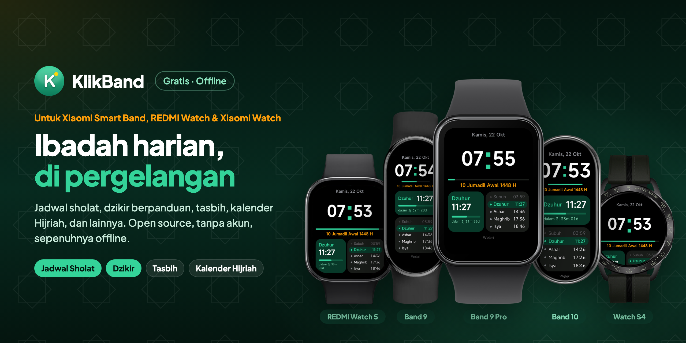

<p align="center">
  
</p>

<p align="center">
  Quick app gratis dan open source untuk perangkat Xiaomi Vela: Xiaomi Smart Band 9, 9 Pro, 8 Pro dan 10, REDMI Watch 5, serta jam bulat Xiaomi Watch S3, S4 dan S5: jam, jadwal sholat, dzikir berpanduan, tasbih, kalender Hijriah, hari besar Islam, panduan umrah, kalender bulanan, hitung hari, dan papan skor. Sepenuhnya offline, tanpa akun.
</p>

<p align="center">
  ⚠️ <b>Tidak resmi.</b> KlikBand adalah quick app Xiaomi Vela buatan komunitas. Tidak dibuat, didukung, maupun disahkan oleh Xiaomi.
</p>

<p align="center">
  <a href="https://github.com/ashafizullah/klikband/releases/latest"></a>
  <a href="https://github.com/ashafizullah/klikband/releases"></a>
  <a href="LICENSE"></a>
  <br>
  
  
  <a href="https://gadgetbridge.org/"></a>
  
</p>

<p align="center">
  <a href="https://trakteer.id/adamshafizullah/tip"></a>
</p>

<p align="center">
  Bagian dari <a href="https://klikapps.pages.dev"><b>Klik Apps</b></a>, kumpulan aplikasi gratis dan open source: <a href="https://klikapps.pages.dev">klikapps.pages.dev</a>
</p>

<p align="center">
  <a href="README.md">English</a> | <b>Bahasa Indonesia</b> | <a href="README.zh.md">中文</a><br>
  <sub>Proyek komunitas, tidak berafiliasi dengan Xiaomi.</sub>
</p>

## Fitur

- **Jam**: halaman bergaya watch face berisi jam, tanggal Masehi dan Hijriah, sholat berikutnya dengan hitung mundur dan bar progres, serta jadwal 5 waktu hari ini (saat Ramadhan, Maghrib tampil sebagai Berbuka), dan dari Maghrib sampai Imsak nama puasa besok. Layar mati seperti biasa; pilih Layar Jam › Nyala terus di Pengaturan agar layar tetap menyala dan getaran waktu sholat datang tepat waktu; geser ke kiri untuk pintasan ke Dzikir Sholat, Dzikir Pagi Petang dan Arah Kiblat; tekan lama untuk ganti tema warna (hijau, biru, emas, ungu, merah muda, monokrom), juga di Pengaturan › Tema Jam
- **Islam**
  - **Hari Ini**: tanggal Masehi dan Hijriah, sholat berikutnya, serta puasa sunnah hari ini dan besok; di hari puasa (Ramadhan atau sunnah) ada hitung mundur ke Imsak atau waktu berbuka beserta nama puasanya, dan di hari Jumat pengingat membaca Al-Kahfi
  - **Dzikir Sholat**: penghitung berpanduan sesuai [Rumaysho](https://rumaysho.com/1997-dzikir-setelah-shalat.html)
  - **Dzikir Pagi Petang**: penghitung berpanduan sesuai [Almanhaj](https://almanhaj.or.id/11518-dzikir-pagi-dan-petang.html)
  - Keduanya menampilkan dzikir dalam transliterasi Latin atau tulisan Arab, dengan Ayat Kursi dan surat-surat ditulis lengkap bernomor ayat (teks [Tanzil](https://tanzil.net))
  - **Jadwal Sholat**: metode Kemenag RI (bawaan) atau metode lain (Liga Muslim Dunia, ISNA, Mesir, Umm al-Qura, Karachi, Dubai), Asar Syafi'i atau Hanafi, dihitung offline di perangkat, lengkap dengan waktu Dhuha, sepertiga malam terakhir dan waktu terlarang sholat; di hari Jumat Dzuhur tampil sebagai Sholat Jumat; bergetar dan menampilkan pesan saat masuk waktu sholat selama halaman Jam, Hari Ini atau Jadwal Sholat terbuka
  - **Arah Kiblat**: arah dan jarak ke Ka'bah dari kotamu, dengan posisi matahari di kompas sehingga cukup menyamakannya dengan matahari sungguhan untuk menghadap kiblat, plus jadwal Rashdul Qiblat
  - **Tasbih**: penghitung ketuk dengan target 33/99/100 dan getar
  - **Hijriah**: kalender Hijriah aritmetika dengan koreksi manual ±2 hari
  - **Hari Besar Islam**: hitung mundur 8 hari besar Islam, diurutkan dari yang terdekat
  - **Asmaul Husna**: 99 nama Allah beserta artinya
  - **Doa-doa Nabi**: 47 doa Nabi ﷺ sesuai [Almanhaj](https://almanhaj.or.id/83989-doa-doa-nabi-shallallahu-alaihi-wa-sallam.html), dalam bacaan Latin atau tulisan Arab (mengikuti pengaturan teks dzikir & doa), dengan arti dan perawinya
  - **Panduan Umrah**: tata cara umrah langkah demi langkah sesuai [Almanhaj](https://almanhaj.or.id/2252-tata-cara-umrah.html), lengkap dengan bacaan dan penghitung putaran thawaf/sa'i
- **Umum**
  - **Kalender**: kalender bulanan dengan tanggal Hijriah, hari besar Islam dan hari puasa ditandai; ketuk tanggal untuk detail
  - **Hitung Hari**: berapa hari menuju atau sejak tanggal pentingmu, bisa diulang bulanan atau tahunan
  - **Papan Skor**: penghitung skor dua sisi: poin bebas, badminton (21 poin, best of 3) atau padel/tenis (15-30-40, deuce, set, tiebreak), dengan tombol batal
  - **Penghitung**: hingga enam penghitung dengan nama pilihan (tamu, orang, barang, putaran, repetisi)
  - **Kalkulator**: + − × ÷ dengan persen dan ganti tanda
- **Pengaturan**: kota (47 kota di Indonesia, WIB/WITA/WIT, atau tempat mana pun di dunia yang dikirim dari HP), metode perhitungan, waktu Asar, bahasa (Indonesia, English, 中文) dan teks dzikir dan doa (Latin atau Arab)
- **Tentang**: versi aplikasi, sumber teks dan perhitungan, serta info perangkat (penyimpanan, model, versi OS dan platform)

Halaman bacaan dan penghitung membuat layar tetap menyala selama dibuka.

## Batasan

Smart Band 9 tidak punya GPS, dan Xiaomi tidak menyediakan API lokasi (`system.geolocation`) maupun internet (`system.fetch`) di band ini. Karena itu KlikBand tidak memakai keduanya di perangkat mana pun: semua berjalan offline, dan kota dipilih manual. Tempat di luar daftar kota bisa dikirim sekali dari HP lewat plugin AstroBox (lihat [Lokasi dari HP](#lokasi-dari-hp)), sampai 65° LU/LS; lebih dekat ke kutub ada hari tanpa matahari terbit atau terbenam.

Tata letaknya dirancang untuk layar Band 9 (192×490) dan menyesuaikan layar perangkatnya:

| Perangkat | Layar | Tata letak | Diuji |
|---|---|---|---|
| Smart Band 9 | 192×490 | band | perangkat asli |
| Smart Band 10 | 212×520 | band | emulator Vela |
| Smart Band 9 Pro, 8 Pro | 336×480 | lebar | emulator Vela (9 Pro) |
| REDMI Watch 5 | 432×514 | lebar | emulator Vela |
| Watch S3, S4, S4 Sport, S5, S1 Pro | bulat 466–480 | bulat | emulator Vela (S4) |

Perangkat bertanda "emulator Vela" belum dicoba di perangkat asli, dan pemasangan lewat Gadgetbridge bisa berbeda tiap model. Laporan sangat diterima.

## Pasang ke band

KlikBand dipasang dari HP **Android** (iPhone belum bisa) lewat [Gadgetbridge](https://gadgetbridge.org/). Pemasangan pertama butuh sekitar 30–45 menit dan sekali memakai komputer, untuk mengambil kunci band dari Mi Fitness. Update berikutnya cukup 1 menit. Langkahnya sama untuk semua band dan jam yang didukung.

👉 **[Panduan pemasangan langkah demi langkah](docs/INSTALL.id.md)** (untuk pemula, lengkap dengan cara mengatasi masalah dan FAQ)

🎬 **[Video tutorial pemasangan](https://youtu.be/WpygHpV-c_4)**

<a href="https://youtu.be/WpygHpV-c_4"></a>

**Cara lain: [AstroBox](https://astrobox.online)** (Android, iOS, Windows, Mac). Sambungkan band di AstroBox dengan akun Xiaomi atau kunci band, lalu buka file `.rpk` dengan AstroBox. Sudah dicoba di Smart Band 9 dari Mac.

## Lokasi dari HP

Untuk tempat yang tidak ada di daftar kota, di mana pun di dunia, pasang plugin **KlikBand** di [AstroBox](https://astrobox.online) (file `KlikBand.abp` di halaman [Releases](https://github.com/ashafizullah/klikband/releases/latest)):

1. Sambungkan band ke AstroBox dan buka KlikBand di band.
2. Di plugin, cari nama kota, pilih hasilnya, cek metode perhitungan (sudah dipilihkan sesuai negaranya), lalu ketuk **Send to band**.
3. Band bergetar dan menampilkan "Lokasi dari HP". Tempat itu tersimpan di band dan muncul paling atas di Pengaturan › Kota.

Cukup sekali; setelah itu semua tetap offline, dan band boleh kembali ke Mi Fitness atau Gadgetbridge. Jadwal ditampilkan dalam jam setempat di tempat itu, sedangkan hitung mundur dan getaran mengikuti waktu sebenarnya, jadi tetap tepat walau jam band masih di zona lain.

## Build

Butuh Node.js.

```
npm install
npm run build      # hasil: dist/*.rpk
```

Plugin AstroBox ada di `plugin/` (Rust, butuh target `wasm32-wasip2`): `plugin/package.sh` menghasilkan `plugin/dist/KlikBand.abp`.

## Struktur proyek

```
src/
├── manifest.json        # info aplikasi dan rute halaman
├── common/
│   ├── i18n.js          # teks antarmuka (id, en, zh) dan pengaturan bahasa
│   ├── prayer.js        # perhitungan jadwal sholat
│   ├── hijri.js         # konversi kalender Hijriah
│   ├── cities.js        # daftar kota, lokasi dari HP, metode dan pengaturan kota
│   ├── phone.js         # pesan dari plugin AstroBox (interconnect)
│   ├── asmaulhusna.js   # data 99 Asmaul Husna
│   ├── duas.js          # data doa-doa Nabi
│   ├── umrah.js         # data panduan umrah
│   ├── dhikr.js         # dzikir setelah sholat
│   ├── dhikrmorningevening.js  # dzikir pagi dan petang
│   ├── arabicdhikr.js   # hasil generate: teks Arab dzikir -> gambar
│   ├── arabicduas.js    # hasil generate: teks Arab doa -> gambar
│   ├── arabic/          # hasil generate: dzikir dan doa Arab sebagai gambar
│   ├── fasting.js       # hari puasa sunnah dan hari dilarang puasa
│   ├── holidays.js      # tanggal hari besar Islam
│   ├── calendar.js      # grid kalender bulanan
│   ├── countdown.js     # data dan perhitungan Hitung Hari
│   ├── text.js          # bantuan marquee untuk label panjang
│   └── icons/           # ikon menu
└── pages/               # satu folder per layar
plugin/                  # plugin KlikBand untuk AstroBox (Rust → WebAssembly)
tools/
└── arabic-images.py     # menggambar dzikir dan doa Arab sebagai gambar
```

Jam tidak bisa menyambung huruf Arab, jadi dzikir dan doa Arab ditampilkan sebagai gambar dengan font Amiri. Setelah mengubah teks `arabic`, jalankan `pip install uharfbuzz freetype-py pillow` sekali, lalu `python3 tools/arabic-images.py`.

Untuk mengganti kota bawaan, ubah entri pertama di `src/common/cities.js`.

## Penafian

**Gunakan dengan risiko sendiri.** Software ini diberikan "apa adanya", tanpa jaminan apa pun (lihat [LICENSE](LICENSE)).

- Memasang aplikasi lewat Gadgetbridge tidak didukung resmi oleh Xiaomi. Proses pairing bisa membuat band perlu di-reset atau dipasangkan ulang.
- Jadwal sholat dan tanggal Hijriah adalah hasil perhitungan. Bisa berbeda beberapa menit atau ±1 hari dari ketetapan resmi; tetap ikuti jadwal masjid setempat atau Kemenag.
- Bacaan dzikir dan doa mengikuti sumber yang dicantumkan, tetapi transliterasi dan terjemahannya mungkin ada kekeliruan. Koreksi dipersilakan.
- KlikBand adalah proyek komunitas dan tidak berafiliasi dengan maupun didukung oleh Xiaomi.

## Dukungan

KlikBand gratis. Kalau bermanfaat, **[traktir saya token AI di Trakteer](https://trakteer.id/adamshafizullah/tip)** ☕🤖.

## Lisensi

[MIT](LICENSE). Gambar teks Arab dibuat dengan font [Amiri](https://github.com/aliftype/amiri) (SIL Open Font License, `tools/fonts/OFL.txt`). Teks Al-Qur'an: Tanzil Quran Text (Simple Plain, Version 1.1), © Tanzil Project, CC BY 3.0 dengan [ketentuan Tanzil](https://tanzil.net/docs/text_license) (hanya salinan apa adanya, sumber disebut dengan tautan ke [tanzil.net](https://tanzil.net)); KlikBand hanya menambahkan nomor ayat. Ikon di `src/common/icons/` dan `kaaba.png` adalah karya asli yang dibuat untuk KlikBand.

<p>
  <a href="https://github.com/ashafizullah"></a>
  &nbsp;Dibuat oleh <a href="https://github.com/ashafizullah"><b>Adam Suchi Hafizullah</b></a>
</p>
