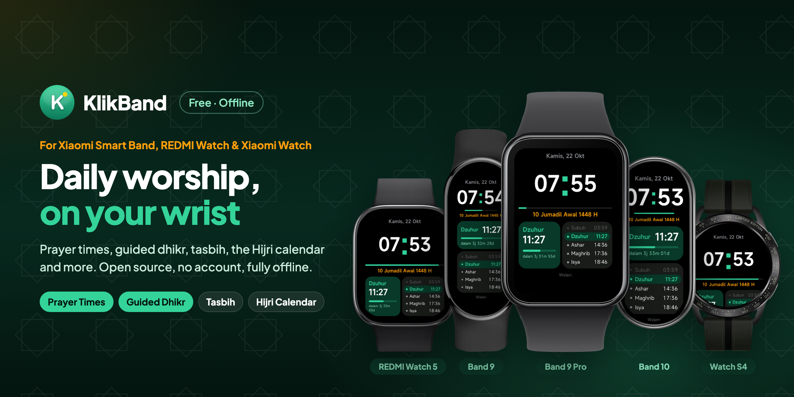

<p align="center">
  
</p>

<p align="center">
  A free, open-source quick app for Xiaomi Vela wearables: Xiaomi Smart Band 9, 9 Pro, 8 Pro and 10, REDMI Watch 5, and the round Xiaomi Watch S3, S4 and S5: a clock, prayer times, guided dhikr, tasbih, Hijri date, Islamic holidays, an umrah guide, a calendar, a day counter and a scoreboard. Fully offline, no account.
</p>

<p align="center">
  ⚠️ <b>Unofficial.</b> KlikBand is a community-made Xiaomi Vela quick app. It is not made, endorsed or supported by Xiaomi.
</p>

<p align="center">
  <a href="https://github.com/ashafizullah/klikband/releases/latest"></a>
  <a href="https://github.com/ashafizullah/klikband/releases"></a>
  <a href="LICENSE"></a>
  <br>
  
  
  <a href="https://gadgetbridge.org/"></a>
  
</p>

<p align="center">
  <a href="https://trakteer.id/adamshafizullah/tip"></a>
</p>

<p align="center">
  Part of <a href="https://klikapps.pages.dev"><b>Klik Apps</b></a>, a family of free, open-source apps: <a href="https://klikapps.pages.dev">klikapps.pages.dev</a>
</p>

<p align="center">
  <b>English</b> | <a href="README.id.md">Bahasa Indonesia</a> | <a href="README.zh.md">中文</a><br>
  <sub>Community project, not affiliated with Xiaomi.</sub>
</p>

## Features

- **Clock**: a watch-face-style page with the time, Gregorian and Hijri date, the next prayer with a countdown and progress bar, and today's five prayers (in Ramadan, Maghrib shows as Iftar), and from Maghrib until Imsak, the coming day's fast. The screen turns off as usual; turn on Clock screen › Always on in Settings to keep it on so the prayer-time buzz arrives on time; swipe left for shortcuts to Post-prayer Dhikr, Morning & Evening Dhikr and Qibla; long-press to switch the color theme (green, blue, gold, purple, rose, mono), also under Settings › Clock theme
- **Islam**
  - **Today**: Gregorian and Hijri date, next prayer, and sunnah fasts for today and tomorrow; on a fast day, a countdown to Imsak or iftar; on Fridays, a reminder to recite Al-Kahf
  - **Post-prayer Dhikr**: guided counter following [Rumaysho](https://rumaysho.com/1997-dzikir-setelah-shalat.html)
  - **Morning & Evening Dhikr**: guided counter following [Almanhaj](https://almanhaj.or.id/11518-dzikir-pagi-dan-petang.html)
  - Both show the dhikr in Latin transliteration or in Arabic, with Ayat al-Kursi and the surahs in full, numbered by verse ([Tanzil](https://tanzil.net) text)
  - **Prayer Times**: Indonesian Ministry of Religious Affairs (Kemenag) method, computed offline on the device, with Duha, the last third of the night and the times prayer is not allowed; on Fridays Dhuhr shows as Jumu'ah; buzzes and shows a message when a prayer time arrives while Clock, Today or Prayer Times is open
  - **Qibla**: direction and distance to the Kaaba from your city, with the sun drawn on the dial so lining it up with the real sun points you to the Qibla, and the yearly sun-over-Kaaba dates
  - **Tasbih**: tap counter with a 33/99/100 target and vibration
  - **Hijri Date**: arithmetic Hijri calendar with a ±2 day manual correction
  - **Islamic Holidays**: countdown to 8 Islamic holidays, nearest first
  - **Asmaul Husna**: the 99 Names of Allah with meanings
  - **Prophet's Duas**: 47 duas of the Prophet ﷺ following [Almanhaj](https://almanhaj.or.id/83989-doa-doa-nabi-shallallahu-alaihi-wa-sallam.html), in Latin transliteration or Arabic (per the dhikr & dua text setting), with meaning and narrator
  - **Umrah Guide**: step-by-step umrah following [Almanhaj](https://almanhaj.or.id/2252-tata-cara-umrah.html), with duas and a tawaf/sa'i round counter
- **General**
  - **Calendar**: monthly calendar with Hijri dates, Islamic holidays and fasting days marked; tap a day for details
  - **Day Counter**: days until or since your own dates, with monthly or yearly repeat
  - **Scoreboard**: two-side counter with free points, badminton (21 points, best of 3) or padel/tennis scoring (15-30-40, deuce, sets, tiebreak), with undo
  - **Counter**: up to six tally counters with preset names (guests, people, items, laps, reps)
  - **Calculator**: + − × ÷ with percent and sign change
- **Settings**: city (47 Indonesian cities, WIB/WITA/WIT), language (Indonesian, English, 中文) and dhikr and dua text (Latin or Arabic)
- **About**: app version, the sources of the texts and calculations, and device info (storage, model, OS and platform version)

Reading and counting pages keep the screen on while open.

## Limitations

The Smart Band 9 has no GPS, and Xiaomi does not offer the location (`system.geolocation`) or internet (`system.fetch`) APIs on it. KlikBand therefore uses neither, on any device: everything runs offline, and the city is picked manually.

The layout is designed for the Band 9 screen (192×490) and adapts to the screen it runs on:

| Device | Screen | Layout | Tested |
|---|---|---|---|
| Smart Band 9 | 192×490 | band | real device |
| Smart Band 10 | 212×520 | band | Vela emulator |
| Smart Band 9 Pro, 8 Pro | 336×480 | wide | Vela emulator (9 Pro) |
| REDMI Watch 5 | 432×514 | wide | Vela emulator |
| Watch S3, S4, S4 Sport, S5, S1 Pro | round 466–480 | round | Vela emulator (S4) |

Devices marked "Vela emulator" have not been tried on real hardware yet, and installing through Gadgetbridge may differ per model. Reports are welcome.

## Install on the band

KlikBand is installed from an **Android** phone (iPhone is not supported) with [Gadgetbridge](https://gadgetbridge.org/). The first time takes about 30–45 minutes and needs a computer once, to read the band's key from Mi Fitness. Updates take a minute. The steps are the same for every supported band and watch.

👉 **[Step-by-step install guide](docs/INSTALL.md)** (written for beginners, with troubleshooting and FAQ)

🎬 **[Video tutorial](https://youtu.be/WpygHpV-c_4)** (in Indonesian)

<a href="https://youtu.be/WpygHpV-c_4"></a>

## Build

Requires Node.js.

```
npm install
npm run build      # output: dist/*.rpk
```

## Project structure

```
src/
├── manifest.json        # app info and page routes
├── common/
│   ├── i18n.js          # UI strings (id, en, zh) and language setting
│   ├── prayer.js        # prayer time calculation
│   ├── hijri.js         # Hijri calendar conversion
│   ├── cities.js        # city list and city setting
│   ├── asmaulhusna.js   # 99 Names data
│   ├── duas.js          # Prophet's duas data
│   ├── umrah.js         # umrah guide steps and readings
│   ├── dhikr.js         # post-prayer dhikr
│   ├── dhikrmorningevening.js  # morning and evening dhikr
│   ├── arabicdhikr.js   # generated: Arabic dhikr text -> images
│   ├── arabicduas.js    # generated: Arabic dua text -> images
│   ├── arabic/          # generated: Arabic dhikr and duas drawn as images
│   ├── fasting.js       # sunnah and forbidden fasting days
│   ├── holidays.js      # Islamic holiday dates
│   ├── calendar.js      # monthly calendar grid
│   ├── countdown.js     # day counter entries and date math
│   ├── text.js          # marquee helpers for long labels
│   └── icons/           # menu icons
└── pages/               # one folder per screen
tools/
└── arabic-images.py     # draws the Arabic dhikr and duas as images
```

The watch cannot join Arabic letters, so the Arabic dhikr and duas are shown as images drawn in the Amiri font. After changing an `arabic` text, run `pip install uharfbuzz freetype-py pillow` once, then `python3 tools/arabic-images.py`.

To change the default city, edit the first entry in `src/common/cities.js`.

## Disclaimer

**Use at your own risk.** This software is provided "as is", without warranty of any kind (see [LICENSE](LICENSE)).

- Installing apps through Gadgetbridge is not supported by Xiaomi. Pairing may require resetting or re-pairing the band.
- Prayer times and Hijri dates are calculated. They may differ by a few minutes or ±1 day from official announcements; follow your local mosque or authority.
- Dhikr and dua texts follow the cited sources, but the transliterations and translations may contain mistakes. Corrections are welcome.
- KlikBand is a community project and is not affiliated with or endorsed by Xiaomi.

## Support

KlikBand is free. If it saves you time, **[buy me an AI token on Trakteer](https://trakteer.id/adamshafizullah/tip)** ☕🤖.

## License

[MIT](LICENSE). The Arabic images are drawn with the [Amiri](https://github.com/aliftype/amiri) font (SIL Open Font License, `tools/fonts/OFL.txt`). Qur'an text: Tanzil Quran Text (Simple Plain, Version 1.1), © Tanzil Project, CC BY 3.0 with [Tanzil's terms](https://tanzil.net/docs/text_license) (verbatim copies only, source credited with a link to [tanzil.net](https://tanzil.net)); KlikBand only adds verse numbers. The icons in `src/common/icons/` and `kaaba.png` are original artwork made for KlikBand.

<p>
  <a href="https://github.com/ashafizullah"></a>
  &nbsp;Built by <a href="https://github.com/ashafizullah"><b>Adam Suchi Hafizullah</b></a>
</p>
