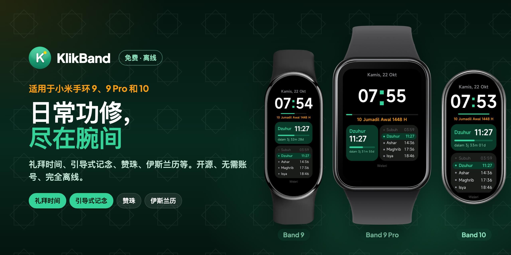

<p align="center">
  
</p>

<p align="center">
  适用于小米手环 9 的免费开源快应用，并为小米手环 9 Pro 提供专门布局（小米手环 10 应该也可用）：时钟、礼拜时间、引导式记念、赞珠、伊斯兰历、伊斯兰节日、副朝指南、日历、倒数日和记分牌。完全离线，无需账号。
</p>

<p align="center">
  <a href="https://github.com/ashafizullah/klikband/releases/latest"></a>
  <a href="https://github.com/ashafizullah/klikband/releases"></a>
  <a href="LICENSE"></a>
  <br>
  
  
  <a href="https://gadgetbridge.org/"></a>
  
</p>

<p align="center">
  <a href="https://trakteer.id/adamshafizullah/tip"></a>
</p>

<p align="center">
  <a href="https://klikapps.pages.dev"><b>Klik Apps</b></a> 系列应用之一，免费开源：<a href="https://klikapps.pages.dev">klikapps.pages.dev</a>
</p>

<p align="center">
  <a href="README.md">English</a> | <a href="README.id.md">Bahasa Indonesia</a> | <b>中文</b><br>
  <sub>社区项目，与小米无关。</sub>
</p>

## 功能

- **时钟**：表盘风格页面，显示时间、公历和伊斯兰历日期、下一次礼拜的倒计时和进度条，以及今天的五次礼拜；向左滑动可快速进入礼拜后记念、早晚记念和朝向
- **伊斯兰**
  - **今日**：公历和伊斯兰历日期、下一次礼拜，以及今明两天的副功斋
  - **礼拜后记念**：按 [Almanhaj](https://almanhaj.or.id/97313-dzikir-setelah-shalat.html) 顺序引导计数
  - **早晚记念**：按 [Almanhaj](https://almanhaj.or.id/11518-dzikir-pagi-dan-petang.html) 顺序引导计数
  - **礼拜时间**：采用印度尼西亚宗教部（Kemenag）算法，在手环上离线计算；在时钟、今日或礼拜时间页面打开时，到点振动并显示提示
  - **朝向**：从所在城市到天房的方向和距离，表盘上显示太阳位置，对准真实太阳即可面向朝向，并列出每年太阳直射天房的日期
  - **赞珠**：点按计数，可设 33/99/100 目标，并有振动提示
  - **伊斯兰历**：算术伊斯兰历，可手动校正 ±2 天
  - **伊斯兰节日**：8 个伊斯兰节日倒计时，按远近排序
  - **真主九十九尊名**：99 个尊名及其含义
  - **先知的祈祷**：按 [Almanhaj](https://almanhaj.or.id/83989-doa-doa-nabi-shallallahu-alaihi-wa-sallam.html) 收录先知 ﷺ 的 47 段祈祷，附拉丁转写、含义和辑录者
  - **副朝指南**：按 [Almanhaj](https://almanhaj.or.id/2252-tata-cara-umrah.html) 的副朝步骤，附念词及环绕/奔走圈数计数
- **通用**
  - **日历**：月历，显示伊斯兰历日期，并标注伊斯兰节日和斋戒日；点按日期查看详情
  - **倒数日**：距离或自某个日期的天数，可按月或按年重复
  - **记分牌**：双方计分：自由计分、羽毛球（21 分，三局两胜）或板式网球/网球（15-30-40、平分、盘、抢七），可撤销
  - **计数器**：最多六个计数器，可选名称（客人、人数、物品、圈数、次数）
  - **计算器**：加减乘除，支持百分比和正负号
- **设置**：城市（印度尼西亚 46 个城市，WIB/WITA/WIT 时区）和语言（印尼语、英语、中文）
- **关于**：应用版本和设备信息（存储空间、型号、系统和平台版本）

阅读和计数页面打开时屏幕保持常亮。

## 限制

小米手环 9 没有 GPS，小米也未在该手环上开放定位（`system.geolocation`）和网络（`system.fetch`）接口。所有功能均离线运行，城市需手动选择。

界面按小米手环 9 的屏幕（192×490）设计。小米手环 9 Pro（336×480）有专门布局，小米手环 10（212×520）沿用手环 9 的布局；两者仅在 Vela 模拟器中检查过，未在真机上测试。不支持圆形屏幕（小米/REDMI 手表）。

## 安装到手环

KlikBand 通过 **Android** 手机（不支持 iPhone）上的 [Gadgetbridge](https://gadgetbridge.org/) 安装。首次安装约需 30–45 分钟，并需要用一次电脑从 Mi Fitness 读取手环钥匙。之后更新只要 1 分钟。

👉 **[分步安装指南](docs/INSTALL.zh.md)**（面向新手，含常见问题和问答）

## 构建

需要 Node.js。

```
npm install
npm run build      # 输出：dist/*.rpk
```

## 项目结构

```
src/
├── manifest.json        # 应用信息和页面路由
├── common/
│   ├── i18n.js          # 界面文字（id、en、zh）和语言设置
│   ├── prayer.js        # 礼拜时间计算
│   ├── hijri.js         # 伊斯兰历换算
│   ├── cities.js        # 城市列表和城市设置
│   ├── asmaulhusna.js   # 九十九尊名数据
│   ├── duas.js          # 先知的祈祷数据
│   ├── umrah.js         # 副朝指南数据
│   ├── dhikr.js         # 礼拜后记念
│   ├── dhikrmorningevening.js  # 早晚记念
│   ├── fasting.js       # 副功斋与禁斋日
│   ├── holidays.js      # 伊斯兰节日日期
│   ├── calendar.js      # 月历网格
│   ├── countdown.js     # 倒数日数据与日期计算
│   ├── text.js          # 长标签滚动显示辅助函数
│   └── icons/           # 菜单图标
└── pages/               # 每个页面一个文件夹
```

如需更改默认城市，请修改 `src/common/cities.js` 中的第一项。

## 免责声明

**使用风险自负。** 本软件按"原样"提供，不附带任何形式的保证（见 [LICENSE](LICENSE)）。

- 通过 Gadgetbridge 安装应用不受小米官方支持，配对过程可能需要重置或重新配对手环。
- 礼拜时间和伊斯兰历日期为计算结果，可能与官方公布相差几分钟或 ±1 天，请以当地清真寺或主管部门为准。
- 记念词和祈祷词依据所注明的来源，但拉丁转写和翻译可能有误，欢迎指正。
- KlikBand 是社区项目，与小米无关，也未获小米认可。

## 许可证

[MIT](LICENSE)
